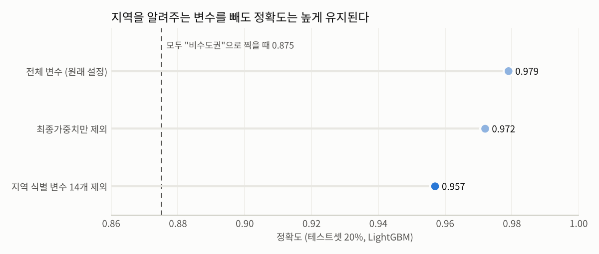

# 주거 이동 데이터 기반 비수도권 정착 요인 분석

2023년 **주거실태조사** 마이크로데이터(약 6.1만 가구)로 수도권/비수도권 거주 가구를 구분하는 모델을 만들고, 어떤 주거·가구 특성이 비수도권 거주와 연결되는지 살펴본 프로젝트입니다. 통계청 공모전 출품작이며, 기간은 2025.05~2025.08입니다.

> **이 저장소를 볼 때 먼저 알아둘 점**
> 모델의 타깃은 "현재 거주 시도가 비수도권인가"입니다. 정확도 0.98은 **어느 지역에 사는 가구인지**를 잘 구분한다는 뜻이고, 비수도권 정착을 **결정하는** 요인을 그대로 보여주는 것은 아닙니다. 아래 [검증](#검증-이-성능은-어디서-오는가) 절에서 직접 확인한 내용을 정리했습니다.

## 리서치 질문

1. 비수도권 거주 여부에 구조적으로 연결된 주요 요인은 무엇인가?
2. 주거·가구·이전 거주 이력 요인은 어떤 방향으로 작용하는가?
3. 정책으로 조정·개선할 수 있는 요인은 무엇인가?

## 데이터

| 항목 | 내용 |
|---|---|
| 주 데이터 | 국토교통부 2023 주거실태조사 일반가구 마이크로데이터 (61,260가구 × 361개 문항) |
| 보조 데이터 | 2020 인구주택총조사 2% 표본, 국내인구이동통계 (초기 탐색에 사용) |
| 타깃 | 비수도권 거주 여부 (서울·인천·경기 = 0, 그 외 = 1) |
| 클래스 비율 | 비수도권 87.5% / 수도권 12.5% |

## 분석 흐름

| 단계 | 노트북 | 내용 |
|---|---|---|
| 1 | [01_migrant_profile_eda](notebooks/01_migrant_profile_eda.ipynb) | 수도권↔비수도권 이주자의 연령·직업·학력·혼인·출생지 분포, 이주 사유, 주거 불만족 요인 군집화 |
| 2 | [02_housing_satisfaction_regression](notebooks/02_housing_satisfaction_regression.ipynb) | 비수도권 정착 가구의 주택 만족도에 영향을 주는 요인 (OLS, Lasso, VIF) |
| 3 | [03_settlement_prediction_models](notebooks/03_settlement_prediction_models.ipynb) | 6개 분류 모델 비교, SMOTE, LightGBM + SHAP 해석 |
| 4 | [04_validation_region_leakage](notebooks/04_validation_region_leakage.ipynb) | 높은 성능이 지역 식별 변수에서 오는지 검증 |

## 주요 결과

### 1. 이주자 특성 (01)

- 수도권 → 비수도권 이주자는 30대 전후, 기혼, 가족 단위가 중심이고, 출생지로 돌아가거나 인접 지역으로 옮기는 경우가 많았습니다.
- 비수도권 → 수도권 이주의 주된 사유는 직장 접근성과 생활 인프라였습니다.

### 2. 주택 만족도 (02)

비수도권 정착 가구의 전반적 주택 만족도를 OLS로 분석한 결과, **주택 구조 상태 만족도**(계수 +0.38)와 **상업시설 접근성**(+0.13)의 영향이 가장 컸습니다.

### 3. 분류 모델 비교 (03)

SMOTE로 학습 데이터 불균형을 보정한 뒤, 테스트셋 20%로 평가했습니다.

| 모델 | Accuracy | Precision | Recall | F1 | ROC-AUC |
|---|---|---|---|---|---|
| **LightGBM** | **0.981** | **0.988** | **0.990** | **0.989** | **0.996** |
| CatBoost | 0.976 | 0.985 | 0.987 | 0.986 | 0.994 |
| XGBoost | 0.973 | 0.983 | 0.986 | 0.984 | 0.994 |
| Random Forest | 0.946 | 0.968 | 0.971 | 0.969 | 0.973 |
| KNN | 0.780 | 0.948 | 0.792 | 0.863 | 0.800 |
| SVM | 0.829 | 0.912 | 0.891 | 0.902 | 0.673 |

LightGBM의 SHAP 상위 변수는 `최종가중치`, `동부/읍면부 구분`, `직전 거주지(시군구)`, `현재 주택가격`이었고, 그 뒤로 주거지원 프로그램 인지 여부와 주택 유형이 이어졌습니다.

## 검증: 이 성능은 어디서 오는가?

SHAP 상위 변수 중 `최종가중치`(지역별로 다르게 매겨지는 표본 가중치), `동부/읍면부`, `직전 거주지`는 응답자가 어느 지역에 사는지를 거의 직접 알려줍니다. 그래서 이 변수들을 빼고 같은 조건으로 다시 학습해 봤습니다 ([04](notebooks/04_validation_region_leakage.ipynb)).



| 설정 | 변수 수 | Accuracy | ROC-AUC |
|---|---|---|---|
| 전체 변수 (원래 설정) | 446 | 0.979 | 0.995 |
| 최종가중치만 제외 | 445 | 0.972 | 0.993 |
| 지역 식별 변수 14개 제외 | 432 | 0.957 | 0.983 |
| 기준선: 모두 "비수도권"으로 예측 | – | 0.875 | 0.500 |

*비교를 단순하게 하려고 SMOTE 없이 같은 분할·같은 설정으로 학습해서 03번 표와 수치가 조금 다릅니다.*

**해석**
- 지역 식별 변수를 모두 빼도 정확도 0.957, AUC 0.983으로 높게 유지됩니다.
- 하지만 이때 상위 변수는 **현재 주택가격, 주택 유형, 보증금, 주택면적**입니다. 수도권과 비수도권의 집값·주택 구조 차이를 학습한 것으로 보입니다.
- 따라서 이 모델은 "비수도권에 **살고 있는** 가구"를 잘 구분하는 모델입니다. 주택가격은 거주 지역의 결과이기도 해서, 이를 비수도권 정착을 **결정하는** 요인으로 해석하는 데는 주의가 필요합니다.

## 정책 시사점 (해석 범위 안에서)

- 비수도권 정착 가구의 주택 만족도는 **주택 구조 상태**와 **생활 편의시설 접근성**에 크게 좌우되므로, 노후 주택 개선과 생활 인프라 확충이 정착 유지에 도움이 될 수 있습니다.
- 주거지원 프로그램 인지 여부도 상위 변수에 포함되어, 지원 금액뿐 아니라 **인지도와 접근성**을 높이는 방향을 검토할 만합니다.

## 한계와 다음 단계

- **타깃 재정의**: 실제 정착 의사결정을 보려면 "비수도권 거주 가구 중 수도권 이주 계획이 있는가"(문33, 문35)처럼 의사결정을 타깃으로 하고, 현재 주택가격처럼 거주 지역의 결과인 변수는 빼고 다시 모델링해야 합니다.
- **단일 연도**: 2023년 횡단면 자료라 인과 관계를 말하기 어렵습니다. 여러 연도나 패널 자료로 확장이 필요합니다.
- **회귀 분석의 변수 처리**: 02번 OLS에서 주택 유형·점유형태 같은 범주형 코드를 연속형으로 넣은 부분이 있어, 더미 변수로 바꿔 재검토가 필요합니다.
- **SMOTE 적용 위치**: 03번에서 SMOTE는 학습셋에만 적용해 테스트셋 오염은 없지만, 교차검증 시에는 Fold마다 따로 적용해야 합니다.

## 폴더 구조

```
housing-settlement-prediction/
├── notebooks/   최종 분석 흐름 (01 → 04)
├── results/     검증 결과
├── images/      README 그림
├── archive/     초기 탐색 노트북 (인구주택총조사 기반, 출력 삭제)
└── data/        원본 데이터 위치 (저장소에는 포함하지 않음)
```

## 실행 방법

```bash
pip install -r requirements.txt
```

1. [MDIS 마이크로데이터 통합서비스](https://mdis.kostat.go.kr)에서 2023년 주거실태조사 일반가구 데이터를 신청해 내려받습니다.
2. 파일을 `2023_일반가구_20250526_59760.csv` 이름으로 노트북과 같은 폴더에 둡니다.
3. `notebooks/`의 노트북을 순서대로 실행합니다.

원본 마이크로데이터는 이용 약관상 재배포할 수 없어 저장소에 포함하지 않았습니다.

## 사용 기술

Python, pandas, scikit-learn, imbalanced-learn (SMOTE), LightGBM, XGBoost, CatBoost, SHAP, statsmodels, geopandas
